# mkxp-z-vita · HardRPG

<p align="center">
  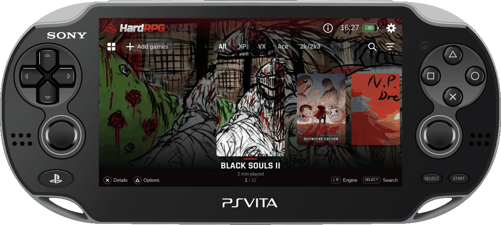
</p>

<p align="center"><b>Play your RPG Maker games on PlayStation Vita</b><br>XP · VX · VX Ace · 2000 · 2003 · Dante 98</p>

<p align="center">
  
  <a href="#status"></a>
  <a href="docs/COMPATIBILITY.md"></a>
  <a href="https://github.com/Asukate/mkxp-z-vita/stargazers"></a>
</p>

<p align="center"><a href="#install">Install</a> · <a href="#add-your-games">Add games</a> · <a href="#what-hardrpg-can-do">Features</a> · <a href="#using-hardrpg">Use</a> · <a href="#per-game-settings-and-controls">Controls</a> · <a href="#artwork-game-info-and-title-music">Artwork</a> · <a href="#compatibility">Compatibility</a> · <a href="#something-went-wrong">Help</a> · <a href="#faq">FAQ</a> · <a href="#building">Build</a> · <a href="#support-hardrpg">Support</a></p>


**HardRPG** plays RPG Maker XP, VX, VX Ace, 2000, 2003 and Dante 98 games on the PS Vita.
Copy your games to the Vita and play them from a game library with covers.
XP, VX and VX Ace games run natively on mkxp-z-vita, this repository's Vita
port of [mkxp-z](https://github.com/mkxp-z/mkxp-z). RPG Maker 2000 and 2003
games run on the [EasyRPG Player](https://easyrpg.org/) that comes built in.
RPG Maker Dante 98 and Dante 98 II games (the PC-98 RPG Makers) run natively
on a built-in port of [OpenDT](https://github.com/MaxSignal/OpenDT).
It is free, open source homebrew for any Vita with HENkaku or Ensō.

## Install

You need a homebrew-enabled Vita. Get HardRPG from these sources:

| Where | How |
| --- | --- |
| [GitHub Releases](https://github.com/Asukate/mkxp-z-vita/releases/latest) | Download the `.vpk`, copy it to the Vita and install it with [VitaShell](https://github.com/TheOfficialFloW/VitaShell). |
| [VitaDB Downloader](https://github.com/Rinnegatamante/VitaDB-Downloader) | On the Vita, search for **HardRPG** and install. |
| [NeoVitaDB Downloader](https://github.com/robin994/NeoVitaDB-Downloader) | On the Vita, search for **HardRPG** and install. |
| [VitaForge](https://github.com/josephinoo/vitaForge) | On the Vita, search for **HardRPG** and install. |

Then open **HardRPG** once. It creates its folders in `ux0:/data/hardrpg/`.

**Updating:** VitaDB Downloader, NeoVitaDB Downloader and VitaForge show when a
new HardRPG is out and install it for you; they can take a few hours or more
after the GitHub release to show it. From GitHub, install the new `.vpk` over
the old one. Your games, saves and settings stay either way.

<details>
<summary>HardRPG closes right away or shows a black screen on start</summary>

HardRPG needs Sony's shader compiler, `libshacccg.suprx`, in `ur0:/data/`.
This is a one-time setup for your console. The easiest way is [VitaDB Downloader](https://github.com/Rinnegatamante/VitaDB-Downloader#changelog),
which installs it for you. You can also follow
[this guide](https://github.com/Rinnegatamante/vitaGL#prerequisites).

</details>

## Add your games

> [!IMPORTANT]
> No games are included. Use games you own.

Copy each game's folder into `ux0:/data/hardrpg/games/`.
Keep the folder exactly as the game ships: the folder with `Game.ini` (or
`RPG_RT.ini` for 2000/2003) inside it.

**Dante 98 games** come as a PC-98 disk image (`.hdi`, `.nhd`, `.fdi`, `.d88`
and similar) or as the game's own files (`PLAYER.DAT` and its `DAT_` files).
Put each game in a folder of its own in `games/`: the disk image alone, or the
image with the Neko Project `.ini` it came with. There is nothing to extract.

```text
ux0:/data/hardrpg/
├── games/
│   ├── My Game/          ← a game folder, as it came
│   └── Another Game/
├── fonts/                ← optional: fonts a game asks for (see below)
└── rtp/                  ← only if a game asks for its RTP
    ├── Standard/         RPG Maker XP
    ├── RPGVX/            RPG Maker VX
    ├── RPGVXAce/         RPG Maker VX Ace
    ├── 2000/             RPG Maker 2000
    └── 2003/             RPG Maker 2003
```

**Games stored somewhere else?** Press **Start** in the library to open the
folder browser, go to the folder, and press **Square** to add the games in it.
They stay where they are.

**Got a game as a ZIP?** Unzip it first, on your PC or on the Vita with
VitaShell, and put the folder in `games/`. HardRPG lists ZIP games but does
not unpack them: on the Vita that takes minutes even for a small game. A ZIP
game already unpacked by an earlier HardRPG still plays.

More detail: [library and settings](launcher/README.md).

### RTP (only if a game needs it)

Some games don't include RPG Maker's standard graphics and sounds, and expect
the **RTP** (Run Time Package) for their engine to be installed separately. If
a game says files are missing, get the RTP for that engine from the official
RPG Maker site:

| Engine | Official download | Copy into |
| --- | --- | --- |
| RPG Maker XP | [xp_rtp104e.exe](https://assets.rpgmakerweb.com/xp_rtp104e.exe) | `rtp/Standard/` |
| RPG Maker VX | [vx_rtp102e.zip](https://assets.rpgmakerweb.com/vx_rtp102e.zip) | `rtp/RPGVX/` |
| RPG Maker VX Ace | [RPGVXAce_RTP.zip](https://assets.rpgmakerweb.com/RPGVXAce_RTP.zip) | `rtp/RPGVXAce/` |
| RPG Maker 2000 | [rpg2000_rtp_installer.exe](https://assets.rpgmakerweb.com/rpg2000_rtp_installer.exe) | `rtp/2000/` |
| RPG Maker 2003 | [rpg2003_rtp_installer.zip](https://assets.rpgmakerweb.com/rpg2003_rtp_installer.zip) | `rtp/2003/` |

These are PC installers, and the Vita can't run them. Unpack the RTP on your
PC first, then copy its folders (`Graphics` and `Audio`, or for 2000/2003
`System`, `Music`, `CharSet` and the rest) into the matching `rtp/` folder.

<details>
<summary><b>Windows</b></summary>

Run the installer. For XP, VX and VX Ace the files end up here; copy what's
inside the folder:

- XP: `C:\Program Files (x86)\Common Files\Enterbrain\RGSS\Standard`
- VX: `C:\Program Files (x86)\Common Files\Enterbrain\RGSS2\RPGVX`
- VX Ace: `C:\Program Files (x86)\Common Files\Enterbrain\RGSS3\RPGVXAce`

For 2000 and 2003, skip installing: open the installer `.exe` with
[7-Zip](https://www.7-zip.org/) and extract it. Copy the extracted folders.

</details>

<details>
<summary><b>Linux and macOS</b></summary>

**1. Install two small tools, once.** Pick your system:

- Arch, CachyOS, EndeavourOS, Manjaro:
  ```bash
  sudo pacman -S innoextract 7zip
  ```
- Debian, Ubuntu, Linux Mint:
  ```bash
  sudo apt install innoextract p7zip-full
  ```
- macOS ([Homebrew](https://brew.sh/)):
  ```bash
  brew install innoextract p7zip
  ```

**2. Unpack the RTP.** Put the file you downloaded in an empty folder, open a
terminal in that folder and run the lines for your engine:

- **XP**
  ```bash
  innoextract xp_rtp104e.exe
  ```
  Copy everything inside `app/` to `ux0:/data/hardrpg/rtp/Standard/`.
- **VX**
  ```bash
  7z x vx_rtp102e.zip
  innoextract RPGVX_RTP/Setup.exe
  ```
  Copy everything inside `app/` to `ux0:/data/hardrpg/rtp/RPGVX/`.
- **VX Ace**
  ```bash
  7z x RPGVXAce_RTP.zip
  innoextract RTP100/Setup.exe
  ```
  Copy everything inside `app/` to `ux0:/data/hardrpg/rtp/RPGVXAce/`.
- **2000**
  ```bash
  7z x rpg2000_rtp_installer.exe -oRTP2000
  ```
  Copy everything inside `RTP2000/` to `ux0:/data/hardrpg/rtp/2000/`.
- **2003**
  ```bash
  7z x rpg2003_rtp_installer.zip
  7z x rpg2003_rtp_installer.exe -oRTP2003
  ```
  Copy everything inside `RTP2003/` to `ux0:/data/hardrpg/rtp/2003/`.

</details>

**Settings → RTP locations** shows which RTPs HardRPG found.

### Original game fonts

Many games use a font from Windows, such as MS Gothic, without including it.
HardRPG then uses a similar built-in font instead (MS Gothic and MS Mincho use
Kosugi, which has the same letter widths). The text reads fine, but it may not
look the way the game's artist intended. To see the game with its original
font, add that font yourself:

1. Start any game once, so HardRPG creates `ux0:/data/hardrpg/fonts/`.
2. Copy the font file into that folder. On Windows, fonts are in
   `C:\Windows\Fonts` (MS Gothic and MS Mincho are `msgothic.ttc` and
   `msmincho.ttc`). `.ttf`, `.otf`, `.ttc` and `.otc` files work.
3. Start the game again.

Every game that asks for that font by name, in English or Japanese, uses it.
A font included in the game's own `Fonts` folder always comes first.

## Status

> [!NOTE]
> HardRPG is in alpha. Many games play well, some have problems, and a few do
> not start. Check the [compatibility list](docs/COMPATIBILITY.md) for your game.

**0.6.0 Alpha** is the current release. New in 0.6.0:

- **Dante 98 and Dante 98 II games:** the PC-98 RPG Makers run natively, from the game's disk image.
- **Cheats:** gold, items, levels, god mode, teleport, switches and more, from the in-game menu.
- **Save backups:** every save a game replaces is kept, and can be restored from the library.
- **New in-game menu:** fills the 16:9 screen; right stick mapping and turbo buttons.
- **Text sized as on Windows:** long lines fit their windows (Hello Charlotte, Mysta's Vore RPG).
- **Fixes:** Orc Strike, Exit Fate's world map and a NoMethodError at start ([#28](https://github.com/Asukate/mkxp-z-vita/issues/28), [#29](https://github.com/Asukate/mkxp-z-vita/issues/29), [#31](https://github.com/Asukate/mkxp-z-vita/issues/31)).
- **Less memory:** game pictures take half the video memory.

Full list: [0.6.0 release notes](docs/RELEASE-NOTES-0.6.0.md).

Older versions: [0.5.3](docs/RELEASE-NOTES-0.5.3.md) · [0.5.2](docs/RELEASE-NOTES-0.5.2.md) ·
[0.5.1](docs/RELEASE-NOTES-0.5.1.md) · [0.5.0](docs/RELEASE-NOTES-0.5.0.md) ·
[0.4.9](docs/RELEASE-NOTES-0.4.9.md) · [0.4.8](docs/RELEASE-NOTES-0.4.8.md) ·
[0.4.7](docs/RELEASE-NOTES-0.4.7.md) · [0.4.6](docs/RELEASE-NOTES-0.4.6.md) ·
[0.4.5](docs/RELEASE-NOTES-0.4.5.md) · [0.4.0](docs/RELEASE-NOTES-0.4.0.md) ·
[0.3.1](docs/RELEASE-NOTES-0.3.1.md) · [0.3.0](docs/RELEASE-NOTES-0.3.0.md) ·
[0.2.1](docs/RELEASE-NOTES-0.2.1.md) · [all releases](https://github.com/Asukate/mkxp-z-vita/releases)

## What HardRPG can do

**Games**

- RPG Maker **XP, VX and VX Ace** games run natively (RGSS1, RGSS2 and RGSS3,
  with real Ruby), including games packed in `Game.rgssad`, `.rgss2a` or
  `.rgss3a` archives.
- RPG Maker **2000 and 2003** games run on the built-in EasyRPG Player, from the
  same library.
- RPG Maker **Dante 98 and Dante 98 II** games (PC-98) run natively on the
  built-in OpenDT port, straight from their disk image, with the same in-game
  menu, controls, screen filters, fast forward and play time as other games.
- Games from Steam, itch.io, DLsite or a free download are added the same
  way: copy the game's folder to the Vita as it is, with nothing to convert or
  repack.
- Some **Pokémon Essentials** fan games (Pokémon Uranium, Pokémon Insurgence)
  partly work.

**Library**

- Carousel, grid and list views, with search, sorting, favourites and one tab
  per engine.
- Covers, backgrounds, logos, screenshots and game details found online by
  itself (Steam, DLsite, VNDB, itch.io and more), or your own pictures.
- Each game's own title music plays while it is highlighted.
- Add games from any folder with the built-in folder browser; they stay where
  they are.
- English, Español, Português (Brasil), 日本語 and 简体中文.

**Controls**

- Remap every button to an RPG Maker button or **any keyboard key**, so games
  made for a PC keyboard play on the Vita.
- **Touch screen and rear touch pad** as buttons: whole surface, halves or four
  corners.
- **Tap to walk:** tap a spot on the map and your character walks there.
- **Right stick:** mirrors the left stick, or works as a mouse pointer, or
  each direction can be any button or key.
- **Turbo buttons:** hold a button and it repeats, at the speed you choose.
- An **on-screen keyboard** for games that ask you to type: tap the keyboard
  icon in the screen's border while playing. Games that ask for a name open it
  by themselves.
- Settings are saved per game.

**While playing**

- **In-game menu:** tap the ☰ icon in the screen's border, or hold
  L + R + Start, to change controls, display, audio and speed without leaving
  the game. It fills the 16:9 screen over the paused game. The keyboard icon
  is right below it.
- **Cheats** (XP, VX, VX Ace and Pokémon Essentials games), in the in-game
  menu: gold, items, weapons and armor, party levels and stats, god mode and
  healing, win or leave a battle, movement speed, teleport with saved spots,
  switches and variables. The basic cheats work in almost every game; games
  that change RPG Maker's own code may not support some of the others.
- **Fast forward** (L + R), up to twice the game's speed.
- **Volume boost** up to 400% for quiet games.
- Display options: aspect ratio, scaling, a Sharp or smooth filter, and
  image quality (16-bit pictures in half the memory, or 32-bit).
- An **FPS and performance overlay** (frame time, CPU, memory, battery).

**Safety**

- **Crash rescue:** if a game stops, start it again and resume from the last
  map change or battle. Your own saves are never touched.
- **Leave and resume:** with crash rescue on, leaving a game keeps your place
  for next time.
- **Save backups:** each save a game replaces is kept outside the game
  folder (5 versions per save by default), and can be put back from the
  game's Saves page, even after the game was removed from the library.
- **Safe saves:** a save cut off by a crash or power loss keeps the old save
  instead of a broken one.
- Error reports you can read and export, to send with a bug report.
- Missing Windows fonts are replaced by matching built-in ones, or use your own.

## Using HardRPG

| Button | In the library |
| --- | --- |
| Left / Right | Move between games |
| Cross | Show the game's details; press again to play |
| Circle | Go back |
| Triangle | Options: favourite, artwork, game settings, rename |
| Square | Show or hide the details |
| Down (in details) | Screenshots; Cross shows one full screen |
| Up | Toolbar: view (carousel, grid or list), engine tabs, search, sort and filter |
| L / R | Show only one engine (XP, VX, Ace, 2000/2003, Dante 98) |
| Select | Search by name |
| Start | Open the folder browser |
| Touch | Drag to scroll, tap to select, tap again to play |

| Buttons | In a game |
| --- | --- |
| **L + R + Start** (hold), or tap ☰ in the screen's border | In-game menu: controls, display, audio, speed, cheats, back to library |
| **L + R** | Fast forward on and off |
| **L + R + Select** (hold) | Back to the library; with crash rescue on, **Resume where you left** returns to that moment |

The in-game menu also opens from the small icon in the screen's empty border.
It pauses the game, and changes apply at once. For RPG Maker 2000/2003
games (EasyRPG), L + R + Select returns to the library; EasyRPG's own menu
is on Start. Dante 98 games have the same in-game menu and buttons as XP, VX
and VX Ace games (crash rescue excepted).

## Per-game settings and controls

Highlight a game, press **Triangle**, then **Game settings**:

- **Controls:** remap the game's controls on a picture of the Vita (below).
- **Display:** aspect ratio, scaling, filtering and image quality.
- **Audio and MIDI:** volume boost (up to 400% for games that stay quiet even
  at full Vita volume, such as Hylics), sound, MIDI reverb and chorus.
- **Performance and speed:** an in-game overlay (FPS, frame timing, or full
  stats with CPU, memory and battery), fast forward, crash rescue and save
  backups.
- **Saves:** every backed up version of each save, with its map, leader,
  level and play time; restore one (the save it replaces is kept too), back
  up now, or put back saves missing from the game.
- **Rename**, **Game information** and **Play**.
- **Remove from library:** takes the game off the list, then asks whether to
  delete its files too (and, for a ZIP game, its unpacked copy). The answer
  is No unless you choose Yes.
- **Delete the ZIP, keep the game:** for a ZIP game that an earlier HardRPG
  already unpacked, frees the ZIP's space; the game keeps playing from its
  unpacked copy.

In **Controls**, every Vita button, and parts of the touch screen and rear pad,
can be set to an RPG Maker button or **any keyboard key**. That makes games
playable that were made for a PC keyboard.

- **Buttons:** pick a button on the picture, press Cross, and choose an RPG
  Maker button or a key from the on-screen keyboard.
- **Touch screen and rear pad:** use the whole surface as one button, split it
  into halves or four corners, shown on the Vita's front and back. Nothing is
  drawn over the game.
- **Tap to walk:** tap a spot on the map and your character walks there.
- **Right stick:** mirrors the left stick by default; or a mouse pointer,
  off, or any button or key per direction.
- **Turbo:** Square on a button's key list turns turbo on for it; the speed
  is set in Controls.
- **Test inputs** shows what each button and touch does before you play.

The same controls, display, volume boost and speed settings are in the in-game menu
(**L + R + Start**), where they apply while you play.

*Example: LISA uses W, A, S and D for combo attacks. Set the rear pad to Four
corners and give each corner one of those keys.*

Details: [controls guide](docs/vita-controls.md).

## Artwork, game info and title music

HardRPG looks up covers, backgrounds, logos, screenshots and details (year,
developer, description) for each new game by itself, in the background, while
it is open and online. Sources: Steam, DLsite, VNDB and itch.io work as they
are; SteamGridDB, IGDB and RAWG need a free key, added in **Settings → Game
info and artwork**, where automatic lookups can also be turned off. When no
source knows a game, its own title screen is used.

**Triangle → Change artwork and info** looks a game up again and lets you pick
the cover, background and logo from what each source found.

**Your own pictures and music:** put them in
`ux0:/data/hardrpg/art/<game name>/` (the game's name, or its folder's or ZIP's
name). They are used instead of downloaded ones:

| File | What it is |
| --- | --- |
| `cover.png` or `.jpg` | The cover in the library |
| `hero.png` or `.jpg` | The background behind it |
| `logo.png` | The title logo on the details page |
| `shot1.png` … `shot4.png` | Screenshots |
| `theme.ogg`, `.mp3` or `.wav` | Title music |

The title music otherwise comes from the game itself: the track its title
screen plays. It is not downloaded. Volume and on/off are in **Settings →
Sound**.

## Compatibility

HardRPG runs RPG Maker XP, VX, VX Ace, 2000, 2003 and Dante 98 games. Some games stop
with a script error, and very demanding games can run slowly.

**Frame rates:** each RPG Maker version has its own speed limit. XP games run
at up to **40 fps**, so 40 fps is full speed for an XP game; a few set their
own limit (Pokémon Uranium runs at up to 50). VX and VX Ace games run at up
to **60 fps**. RPG Maker 2000 and 2003 games run at 60 fps. Dante 98 games
run at the PC-98's **56 fps**.

**Can I play … on the Vita?** Popular games, as tested on a real PS Vita:

| Game | Engine | On HardRPG |
| --- | --- | --- |
| To the Moon | XP | ✅ Yes (slowdowns in some areas) |
| Finding Paradise (Steam) | XP | ✅ Yes, 35–40 fps |
| LISA: The Painful, LISA: The Joyful | VX Ace | ✅ Yes |
| Ao Oni | XP | ✅ Yes, played start to finish |
| Ao Oni R | VX Ace | ✅ Yes |
| The Witch's House (original) | VX | ✅ Yes |
| Hylics | VX Ace | ✅ Yes (slow in some areas) |
| BLACK SOULS, BLACK SOULS II | VX Ace | ✅ Yes |
| Hello Charlotte EP1, EP2, EP3 | VX Ace | ✅ Yes, all played start to finish |
| Pocket Mirror (original 2016 edition) | VX Ace | 🟡 Plays, later parts untested |
| Mogeko Castle (English) | VX Ace | ✅ Yes |
| FNaF b Final Mix | VX Ace | ✅ Yes |
| The Endless Empty | VX Ace | ✅ Yes |
| Red Hood's Woods | VX Ace | ✅ Yes |
| Shin Megami Tensei VX: The Genesis | VX | ✅ Yes |
| N.P.C. Dreams | VX Ace | ✅ Yes |
| Exit Fate | XP | 🟡 Plays (world map fixed in 0.6.0) |
| The Music Box (Mario) | XP | 🟡 Plays, later parts untested |
| OFF, Ib, Yume Nikki, Flow | 2000/2003 | ✅ Yes, through the built-in EasyRPG Player |
| Peret em Heru: For the Prisoners | Dante 98 | ✅ Yes, natively (OpenDT) |
| Corpse Party (1996, PC-98 original) | Dante 98 | 🟡 Plays at full speed with sound and saving, later parts untested |
| Pokémon Uranium, Pokémon Insurgence | XP (Pokémon Essentials) | 🟡 Plays, progression untested |
| Pokémon Infinite Fusion | XP (Pokémon Essentials) | ⛔ No: needs more memory than the Vita gives the game |
| OMORI, Fear & Hunger, Look Outside | MV / MZ | 🛠️ Not yet: MV and MZ support is in development |

A game that is not listed has not been tested yet. Most XP, VX, VX Ace, 2000
and 2003 games start, so try it. The full
[compatibility list](docs/COMPATIBILITY.md) has notes for each game. Played a
game that is not on the list? [Tell us](docs/COMPATIBILITY.md#tested-a-game),
even if it runs fine.

> [!NOTE]
> **Pokémon Essentials games** are new and only partly supported: Pokémon
> Uranium and Pokémon Insurgence play, but some maps and battles run below
> the game's own speed limit; Pokémon Infinite Fusion does not start. Other
> Essentials fan games have not been tested.

## Something went wrong?

When a game stops with an error, HardRPG shows the error when you return to the
library. You can find it again in **Settings → Game error history**, and press
**Square** to export it as a file.

With **crash rescue** on (the default for XP, VX and VX Ace games), starting
the game again offers to resume where it was at the last map change or battle
start. The copy is kept in `ux0:/data/hardrpg/rescue/` and never replaces your
saves.

To report a problem, [open an issue](https://github.com/Asukate/mkxp-z-vita/issues)
and include:

- the game's name and version (and where you got it, such as Steam),
- what you were doing when it happened,
- the exported error report, if there is one.

**Optional, but very helpful: attach your save file.** Many problems only
happen in one place, after certain story events, or with certain items. A save
from just before the problem lets it be reproduced in minutes, instead of
replaying the game to reach the same spot.

### Where saves are

| Game | Save location |
| --- | --- |
| A game folder in `games/` | Inside the game's own folder, usually `Save01.rxdata`, `Save01.rvdata` or `Save01.rvdata2` |
| A ZIP game unpacked by an earlier HardRPG | Inside its unpacked copy in `ux0:/data/hardrpg/cache/` |
| An RPG Maker 2000/2003 game | `ux0:/data/hardrpg/saves/easyrpg/` (files named `Save01.lsd` and so on) |
| A Dante 98 game | `ux0:/data/hardrpg/saves/opendt/`, one folder per game (its disk image stays untouched) |

Some games save in a folder of their own; if you can't find it, mention that
in the report. Older versions of each save (save backups) are in
`ux0:/data/hardrpg/save-backups/`, one folder per game.

### Known issues

- Large games can take a while to start the first time.
- The first time a new HardRPG version starts a game, it prepares its graphics
  for a few seconds ("only once").
- Games whose title music is MIDI have no music in the library.

## FAQ

**Can a PS Vita play RPG Maker games?**
Yes, with homebrew (HENkaku or Ensō). HardRPG plays RPG Maker XP, VX, VX Ace,
2000, 2003 and Dante 98 games. See [Install](#install).

**Can I play RPG Maker XP, VX or VX Ace games on the Vita?**
Yes. HardRPG runs them natively, with a real Ruby interpreter, like the PC
version of the game. Games packed in a `Game.rgssad`, `.rgss2a` or `.rgss3a`
archive work too.

**Can I play To the Moon, LISA, Ao Oni, Hylics, BLACK SOULS or The Witch's House on the Vita?**
Yes, all of them play on HardRPG. See the [popular games table](#compatibility).

**What about RPG Maker MV and MZ games, such as OMORI or Fear & Hunger?**
Not playable yet, but planned and in development. MV and MZ games are web
(JavaScript) games and need a new engine on the Vita. Test games already run
on it, and it is being made faster until they are playable. Follow the
[releases](https://github.com/Asukate/mkxp-z-vita/releases) for news.

**Is this the same as mkxp-vita?**
No. mkxp-vita is an older Vita fork of mkxp without releases. HardRPG is a
Vita port of mkxp-z, the maintained successor of mkxp, with regular releases
you can install.

**How is it different from EasyRPG Player for the Vita?**
EasyRPG Player plays RPG Maker 2000 and 2003 games only. HardRPG includes
EasyRPG Player for those, and adds XP, VX and VX Ace games, all in one library
with covers, per-game controls, crash rescue and the in-game menu. Your 2000
and 2003 games can stay in EasyRPG's folder: add it with the folder browser.

**Can I play my Steam RPG Maker games on the Vita?**
If the game was made with RPG Maker XP, VX, VX Ace, 2000 or 2003, yes. Copy
its folder from Steam's install folder (`steamapps/common/<game>`) to
`ux0:/data/hardrpg/games/`. The folder with `Game.ini` or `RPG_RT.ini` in it
is the one to copy.

**Which RPG Maker made my game?**
Look in the game's folder: `Game.rgssad` or `Data/*.rxdata` is XP, `.rvdata`
is VX, `.rvdata2` or `Game.rgss3a` is VX Ace, `RPG_RT.ldb` is 2000/2003,
`PLAYER.DAT` or a PC-98 disk image (`.hdi`, `.fdi`) is Dante 98, and a
`www` folder or `js/rpg_core.js` is MV/MZ. In HardRPG, **L / R** in the
library shows one engine at a time.

**Where do I download HardRPG, and how do I update it?**
From VitaDB Downloader, NeoVitaDB Downloader, VitaForge or GitHub Releases (see
[Install](#install)). The three Vita stores show updates and install them. From
GitHub, install the new VPK over the old one.

**Will updating HardRPG delete my games or saves?**
No. Game folders, saves and settings stay.

**Does HardRPG come with games?**
No. Copy games you own to the Vita (see [Add your games](#add-your-games)).

**A game says it can't find the RTP. What do I do?**
Install that RPG Maker version's RTP once, as in
[RTP](#rtp-only-if-a-game-needs-it). Every game that needs it then finds it.

**My game came as a ZIP.**
Unzip it on your PC first and copy the folder to `games/`. HardRPG lists ZIP
games but does not unpack them, because that takes minutes on the Vita.

**My games are in another folder.**
Press **Start** in the library, go to that folder and press **Square**. The
games stay where they are.

**Can I use the touch screen?**
Yes. Tap to walk moves your character to the spot you tap, and the touch
screen and rear touch pad can act as buttons or keyboard keys. Turn them on in
**Triangle → Game settings → Controls**.

**Are there cheats?**
Yes. Open the in-game menu (**L + R + Start**, or tap ☰ in the screen's
border) and choose **Cheats**: gold, items, weapons and armor, party levels,
experience and stats, god mode, healing, winning or leaving a battle,
movement speed, teleport, switches and variables. They work in XP, VX, VX Ace
and Pokémon Essentials games. The basic ones work in almost every game; a
game that changes RPG Maker's own code may not support some of the others,
and HardRPG says so instead of changing anything. Nothing changes until you
confirm, and saving in the game keeps what the cheats gave you.

**I overwrote a save by mistake. Can I get it back?**
Yes, with save backups (on by default). Each time an XP, VX, VX Ace, 2000 or
2003 game replaces a save, HardRPG keeps the old one outside the game folder.
Highlight the game, press **Triangle → Game settings → Saves**, pick the save and the version
to restore. The save it replaces is kept as a backup too, so you can switch
back. Backups of a game you removed are in **Settings → Save backups**; add
the game again and its saves come back.

**Can I play PC-98 RPG Maker (Dante 98) games?**
Yes. Dante 98 and Dante 98 II games run natively on HardRPG's built-in OpenDT
port, at the PC-98's full speed, with sound and saving. Put the game's disk
image (`.hdi`, `.fdi`, `.d88` and similar) in a folder of its own in
`games/`; there is nothing to extract. Other PC-98 disks run on the built-in
NP2kai. See [Add your games](#add-your-games).

**Can I use the right stick or turbo?**
Yes. In **Controls**, the right stick mirrors the left stick by default, or
works as a mouse pointer, or each direction can be any button or key. Any
button can be a turbo button that repeats while you hold it.

**Text shows boxes, overlaps or is cut off.**
The game probably wants a Windows font it does not include. See
[Original game fonts](#original-game-fonts) to use your own copy.

**The game needs a keyboard key, or wants me to type a name.**
Map any keyboard key to a Vita button in **Controls**
([Per-game settings](#per-game-settings-and-controls)). For typing, tap the
keyboard button in the screen's left border; games that ask for text open it
by themselves.

**A game is too quiet.**
Turn up **Volume boost** (up to 400%) in the game's audio settings or the
in-game menu.

**A game is slow.**
Check the [compatibility list](docs/COMPATIBILITY.md): some games are known to
drop below 60 fps. The first start after an update prepares graphics for a few
seconds. **L + R** turns fast forward on for slow scenes.

**A game crashed. Did I lose my progress?**
Usually not. With crash rescue on, starting the game again offers to resume at
the last map change or battle. A save cut off by the crash keeps the old save.
Please [report it](#something-went-wrong), with your save if you can.

## Screenshots

The launcher, on a PS Vita running HardRPG 0.4.0:

<table>
  <tr>
    <td align="center">
      <a href="docs/images/screenshots/launcher-home.png">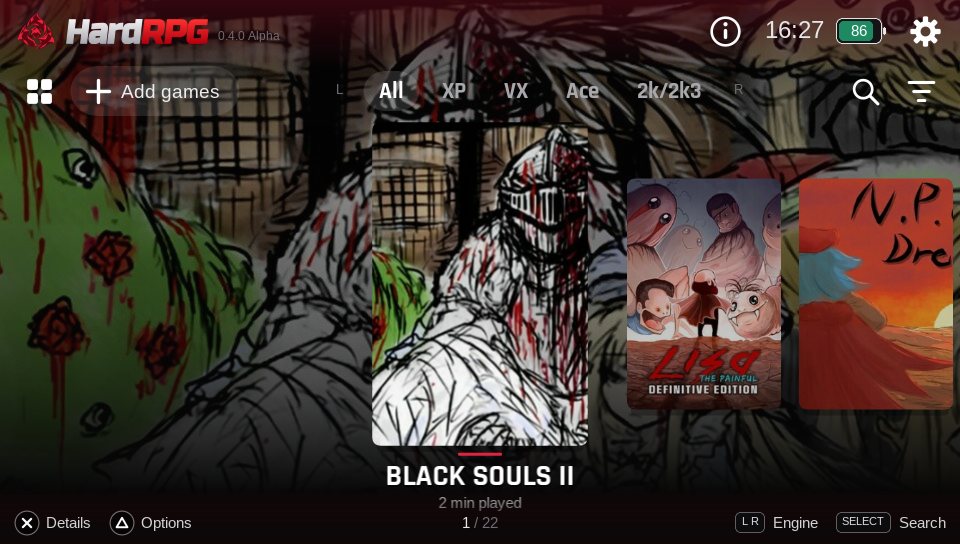</a><br>
      <sub>The library</sub>
    </td>
    <td align="center">
      <a href="docs/images/screenshots/launcher-details.png">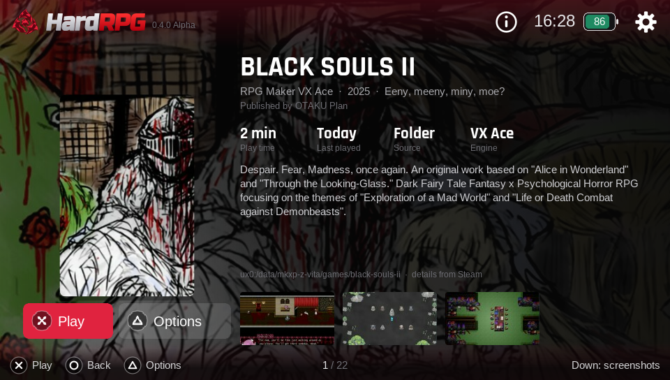</a><br>
      <sub>A game's details</sub>
    </td>
  </tr>
  <tr>
    <td align="center">
      <a href="docs/images/screenshots/launcher-game-settings.png">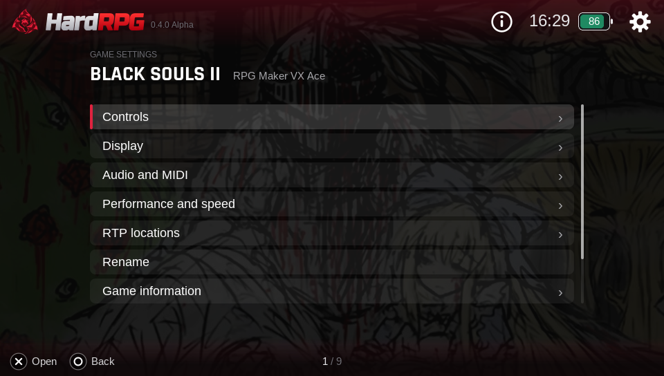</a><br>
      <sub>Settings for each game</sub>
    </td>
    <td align="center">
      <a href="docs/images/screenshots/launcher-controls.png">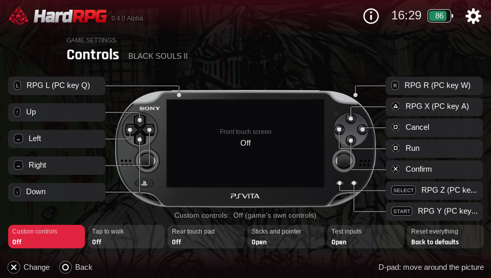</a><br>
      <sub>Controls on a picture of the Vita</sub>
    </td>
  </tr>
  <tr>
    <td align="center">
      <a href="docs/images/screenshots/in-game-keyboard.png">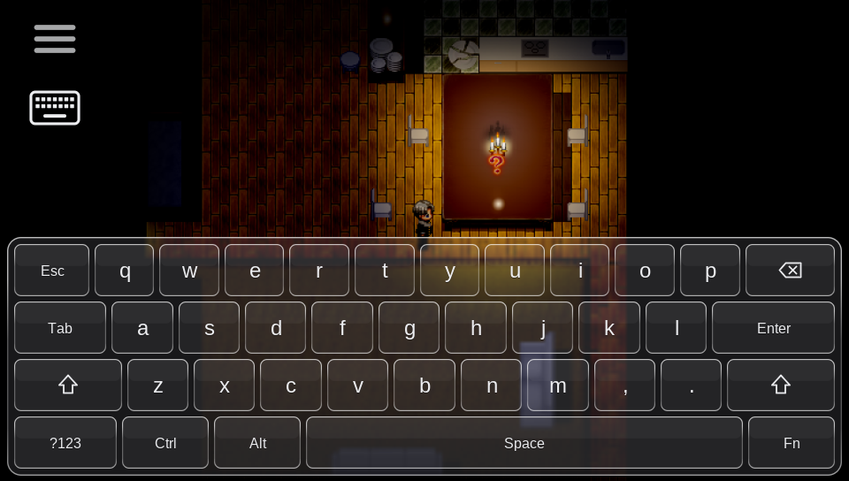</a><br>
      <sub>The in-game keyboard, for games that need typing</sub>
    </td>
    <td></td>
  </tr>
</table>

Games, captured on a PS Vita running HardRPG 0.3.0:

<table>
  <tr>
    <td align="center" width="50%">
      <a href="docs/images/screenshots/to-the-moon.png">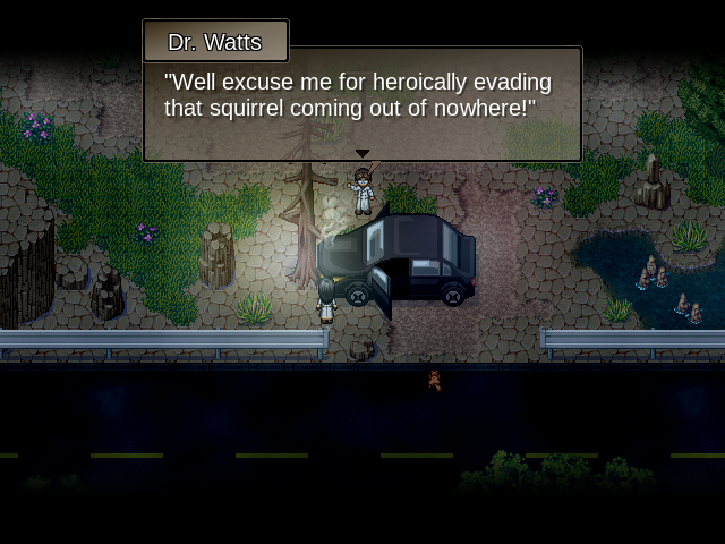</a><br>
      <b>To the Moon</b>
    </td>
    <td align="center" width="50%">
      <a href="docs/images/screenshots/lisa.png">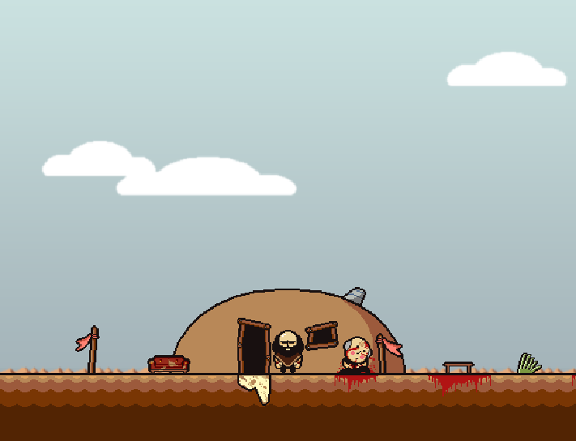</a><br>
      <b>LISA: The Painful</b>
    </td>
  </tr>
  <tr>
    <td align="center" width="50%">
      <a href="docs/images/screenshots/hylics.png">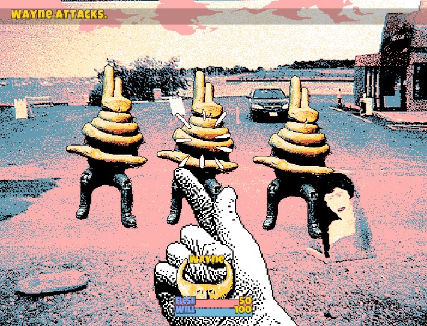</a><br>
      <b>Hylics</b>
    </td>
    <td align="center" width="50%">
      <a href="docs/images/screenshots/the-witchs-house.png">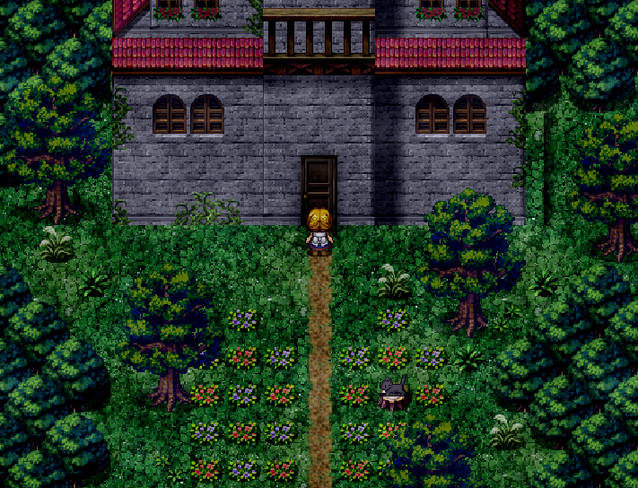</a><br>
      <b>The Witch’s House</b>
    </td>
  </tr>
  <tr>
    <td align="center" width="50%">
      <a href="docs/images/screenshots/ao-oni.png">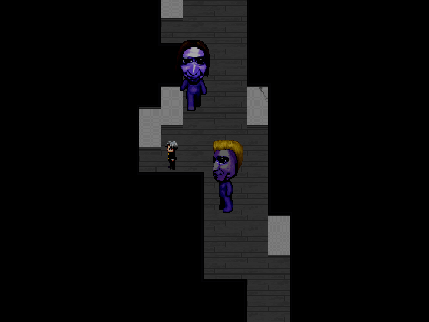</a><br>
      <b>Ao Oni</b>
    </td>
    <td align="center" width="50%">
      <a href="docs/images/screenshots/black-souls.png">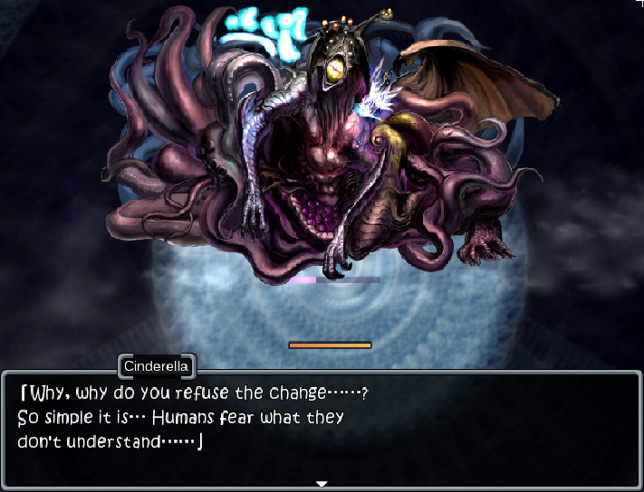</a><br>
      <b>BLACK SOULS</b>
    </td>
  </tr>
  <tr>
    <td align="center" width="50%">
      <a href="docs/images/screenshots/black-souls-ii.png">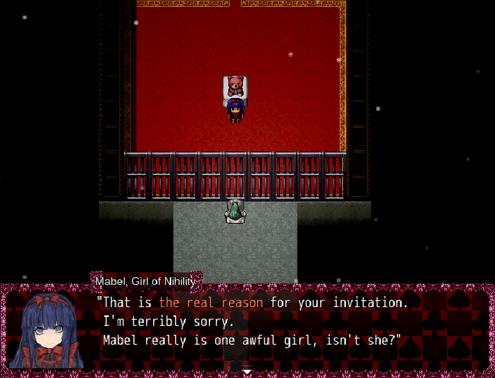</a><br>
      <b>BLACK SOULS II</b>
    </td>
    <td align="center" width="50%">
      <a href="docs/images/screenshots/fnafb-final-mix.png">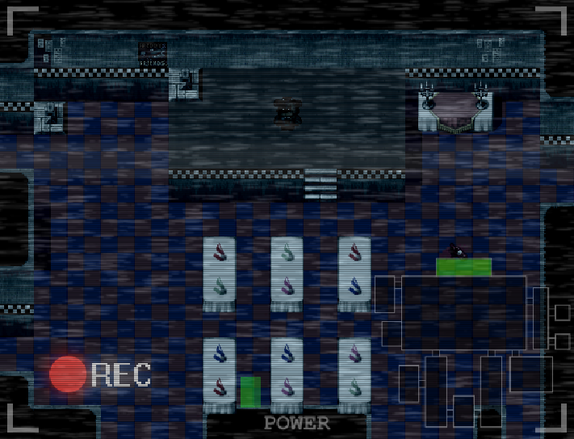</a><br>
      <b>FNaF b Final Mix</b>
    </td>
  </tr>
  <tr>
    <td align="center" width="50%">
      <a href="docs/images/screenshots/mogeko-castle.png">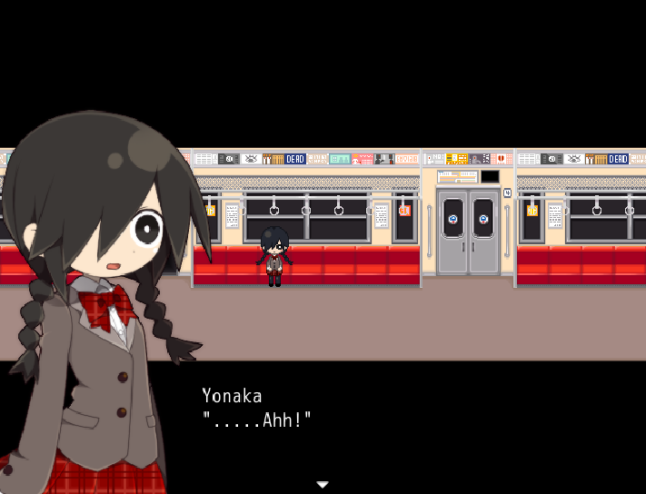</a><br>
      <b>Mogeko Castle</b>
    </td>
    <td align="center" width="50%">
      <a href="docs/images/screenshots/red-hoods-woods.png">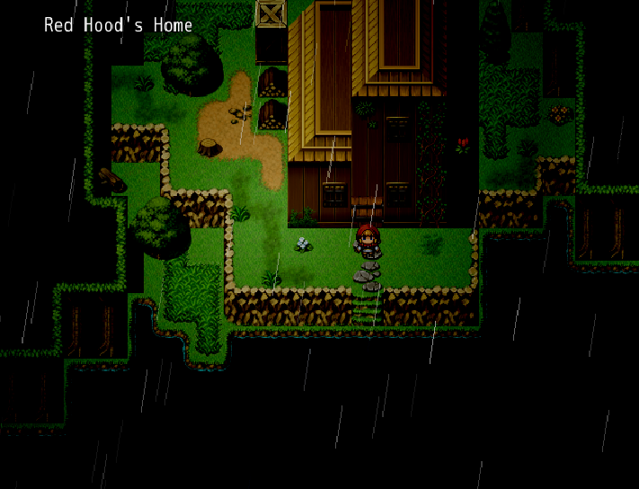</a><br>
      <b>Red Hood’s Woods</b>
    </td>
  </tr>
</table>

<!-- 44693bdd8c93025aa94bdd159c9f6574a8003159acb76820348e098cdec9df0e -->

## Building

For developers: the [build guide](docs/BUILDING.md) covers the VitaSDK
container, dependencies and VPK packaging. The
[desktop launcher preview](docs/LAUNCHER-PREVIEW.md) runs the launcher on a PC
for quick UI work.

| Directory | Purpose |
| --- | --- |
| `src/`, `binding/`, `shader/`, `assets/` | Engine, Ruby bindings, renderer and built-in resources |
| `backends/` | EasyRPG Player integration for RPG Maker 2000/2003; OpenDT (Dante 98) and NP2kai (PC-98) runtimes |
| `launcher/` | Package defaults, scripts loaded into games, LiveArea assets |
| `deps/` | Pinned dependencies and their patches |
| `scripts/`, `ci/` | Build, package, verification and CI |
| `docs/` | Guides, compatibility and README images |

## Support HardRPG

Sponsorship helps fund development, game compatibility fixes, and testing on
real PS Vita hardware. You can support the project monthly or make a one-time
contribution. Both options let you choose your own amount.

[Sponsor HardRPG on GitHub](https://github.com/sponsors/Asukate)

Enjoying HardRPG? A [star on GitHub](https://github.com/Asukate/mkxp-z-vita)
helps other PS Vita players find it, and costs nothing.

## Credits and licenses

HardRPG is developed by [Asukate](https://github.com/Asukate).
Built on [mkxp-z](https://github.com/mkxp-z/mkxp-z) and Ancurio's original mkxp,
with [EasyRPG Player](https://easyrpg.org/),
[OpenDT](https://github.com/MaxSignal/OpenDT) for Dante 98 games,
[NP2kai](https://github.com/libretro/NP2kai), [VitaSDK](https://vitasdk.org/),
Rinnegatamante's [vitaGL](https://github.com/Rinnegatamante/vitaGL) and
[vitaShaRK](https://github.com/Rinnegatamante/vitaShaRK), Ruby, and the other
libraries listed in [third-party notices](THIRD-PARTY-NOTICES.md).

The engine keeps its GPL-2.0-or-later license; components with GPL v3 and
other terms keep their notices and license texts. See [COPYING](COPYING) and
[LICENSES/](LICENSES/). Games belong to their respective owners.

Header illustration: [Tokyoship, Wikimedia Commons](https://commons.wikimedia.org/wiki/File:PlayStation_Vita_illustration.svg),
[CC BY 3.0](https://creativecommons.org/licenses/by/3.0/), modified by adding a
game image to the screen.
