# mkxp-z-vita · HardRPG

<p align="center">
  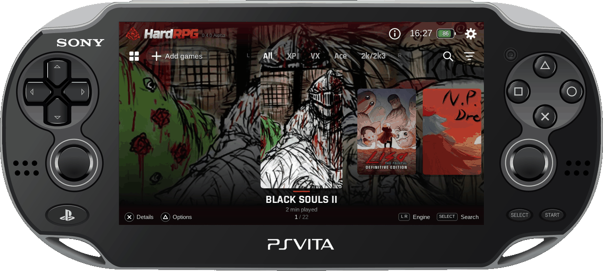
</p>

<p align="center"><b>Play your RPG Maker games on PlayStation Vita</b><br>XP · VX · VX Ace · 2000 · 2003</p>

<p align="center">
  
  <a href="#status"></a>
  <a href="docs/COMPATIBILITY.md"></a>
</p>

<p align="center"><a href="#install">Install</a> · <a href="#add-your-games">Add games</a> · <a href="#using-hardrpg">Use</a> · <a href="#per-game-settings-and-controls">Controls</a> · <a href="#artwork-game-info-and-title-music">Artwork</a> · <a href="#compatibility">Compatibility</a> · <a href="#something-went-wrong">Help</a> · <a href="#building">Build</a></p>


**HardRPG** is an RPG Maker game launcher for the PS Vita. Copy your games to
the Vita and play them. It runs XP, VX and VX Ace games natively (a Vita port
of [mkxp-z](https://github.com/mkxp-z/mkxp-z)) and RPG Maker 2000/2003 games
through a bundled [EasyRPG Player](https://easyrpg.org/).

## Install

You need a Vita with homebrew enabled and [VitaShell](https://github.com/TheOfficialFloW/VitaShell).

1. Download the newest **HardRPG** `.vpk` from [Releases](https://github.com/Asukate/mkxp-z-vita/releases) (the release at the top).
2. Copy it to your Vita and install it with VitaShell.
3. Open **HardRPG** once. It creates its folders in `ux0:/data/hardrpg/`.

<details>
<summary>HardRPG closes right away or shows a black screen on start</summary>

HardRPG needs Sony's shader compiler, `libshacccg.suprx`, in `ur0:/data/`.
This is a one-time setup for your console. The easiest way is [VitaDB Downloader](https://github.com/Rinnegatamante/VitaDB-Downloader#changelog),
which installs it for you. You can also follow
[this guide](https://github.com/Rinnegatamante/vitaGL#prerequisites).

</details>

## Add your games

> [!IMPORTANT]
> No games are included. Use games you own.

Copy each game's folder into `ux0:/data/hardrpg/games/`.
Keep the folder exactly as the game ships: the folder with `Game.ini` (or
`RPG_RT.ini` for 2000/2003) inside it.

```text
ux0:/data/hardrpg/
├── games/
│   ├── My Game/          ← a game folder, as it came
│   └── Another Game/
└── rtp/                  ← only if a game asks for its RTP
    ├── Standard/         RPG Maker XP
    ├── RPGVX/            RPG Maker VX
    ├── RPGVXAce/         RPG Maker VX Ace
    ├── 2000/             RPG Maker 2000
    └── 2003/             RPG Maker 2003
```

**Games stored somewhere else?** Press **Start** in the library to open the
folder browser, go to the folder, and press **Square** to add the games in it.
They stay where they are.

**Got a game as a ZIP?** Unzip it first, on your PC or on the Vita with
VitaShell, and put the folder in `games/`. HardRPG lists ZIP games but does
not unpack them: on the Vita that takes minutes even for a small game. A ZIP
game already unpacked by an earlier HardRPG still plays.

More detail: [library and settings](launcher/README.md).

### RTP (only if a game needs it)

Some games don't include RPG Maker's standard graphics and sounds, and expect
the **RTP** (Run Time Package) for their engine to be installed separately. If
a game says files are missing, get the RTP for that engine from the official
RPG Maker site:

| Engine | Official download | Copy into |
| --- | --- | --- |
| RPG Maker XP | [xp_rtp104e.exe](https://assets.rpgmakerweb.com/xp_rtp104e.exe) | `rtp/Standard/` |
| RPG Maker VX | [vx_rtp102e.zip](https://assets.rpgmakerweb.com/vx_rtp102e.zip) | `rtp/RPGVX/` |
| RPG Maker VX Ace | [RPGVXAce_RTP.zip](https://assets.rpgmakerweb.com/RPGVXAce_RTP.zip) | `rtp/RPGVXAce/` |
| RPG Maker 2000 | [rpg2000_rtp_installer.exe](https://assets.rpgmakerweb.com/rpg2000_rtp_installer.exe) | `rtp/2000/` |
| RPG Maker 2003 | [rpg2003_rtp_installer.zip](https://assets.rpgmakerweb.com/rpg2003_rtp_installer.zip) | `rtp/2003/` |

These are PC installers, and the Vita can't run them. Unpack the RTP on your
PC first, then copy its folders (`Graphics` and `Audio`, or for 2000/2003
`System`, `Music`, `CharSet` and the rest) into the matching `rtp/` folder.

<details>
<summary><b>Windows</b></summary>

Run the installer. For XP, VX and VX Ace the files end up here; copy what's
inside the folder:

- XP: `C:\Program Files (x86)\Common Files\Enterbrain\RGSS\Standard`
- VX: `C:\Program Files (x86)\Common Files\Enterbrain\RGSS2\RPGVX`
- VX Ace: `C:\Program Files (x86)\Common Files\Enterbrain\RGSS3\RPGVXAce`

For 2000 and 2003, skip installing: open the installer `.exe` with
[7-Zip](https://www.7-zip.org/) and extract it. Copy the extracted folders.

</details>

<details>
<summary><b>Linux and macOS</b></summary>

**1. Install two small tools, once.** Pick your system:

- Arch, CachyOS, EndeavourOS, Manjaro:
  ```bash
  sudo pacman -S innoextract 7zip
  ```
- Debian, Ubuntu, Linux Mint:
  ```bash
  sudo apt install innoextract p7zip-full
  ```
- macOS ([Homebrew](https://brew.sh/)):
  ```bash
  brew install innoextract p7zip
  ```

**2. Unpack the RTP.** Put the file you downloaded in an empty folder, open a
terminal in that folder and run the lines for your engine:

- **XP**
  ```bash
  innoextract xp_rtp104e.exe
  ```
  Copy everything inside `app/` to `ux0:/data/hardrpg/rtp/Standard/`.
- **VX**
  ```bash
  7z x vx_rtp102e.zip
  innoextract RPGVX_RTP/Setup.exe
  ```
  Copy everything inside `app/` to `ux0:/data/hardrpg/rtp/RPGVX/`.
- **VX Ace**
  ```bash
  7z x RPGVXAce_RTP.zip
  innoextract RTP100/Setup.exe
  ```
  Copy everything inside `app/` to `ux0:/data/hardrpg/rtp/RPGVXAce/`.
- **2000**
  ```bash
  7z x rpg2000_rtp_installer.exe -oRTP2000
  ```
  Copy everything inside `RTP2000/` to `ux0:/data/hardrpg/rtp/2000/`.
- **2003**
  ```bash
  7z x rpg2003_rtp_installer.zip
  7z x rpg2003_rtp_installer.exe -oRTP2003
  ```
  Copy everything inside `RTP2003/` to `ux0:/data/hardrpg/rtp/2003/`.

</details>

**Settings → RTP locations** shows which RTPs HardRPG found.

## Status

> [!NOTE]
> HardRPG is in alpha. Many games play well, some have problems, and a few do
> not start. Check the [compatibility list](docs/COMPATIBILITY.md) for your game.

**0.4.0 Alpha** is the current release. New in 0.4:

- **A new library:** a carousel of your games with covers, backgrounds,
  details and screenshots, downloaded automatically in the background.
- **Title music:** each game's own title theme plays while it is highlighted.
- **In-game menu:** hold **L + R + Start** (or tap the icon in the screen's
  empty border) to change controls, display and speed without leaving the game.
- **Fast forward:** **L + R** runs a game at up to twice its speed.
- **Faster:** quicker starts, smoother maps and sprites, and a Sharp screen
  filter by default.
- **Español and Português (Brasil)**, and a welcome guide on the first start.

Full list: [0.4.0 release notes](docs/RELEASE-NOTES-0.4.0.md).

## Using HardRPG

| Button | In the library |
| --- | --- |
| Left / Right | Move between games |
| Cross | Show the game's details; press again to play |
| Circle | Go back |
| Triangle | Options: favourite, artwork, game settings, rename |
| Square | Show or hide the details |
| Down (in details) | Screenshots; Cross shows one full screen |
| Up | Toolbar: grid view, engine tabs, search, sort and filter |
| L / R | Show only one engine (XP, VX, Ace, 2000/2003) |
| Select | Search by name |
| Start | Open the folder browser |
| Touch | Drag to scroll, tap to select, tap again to play |

| Buttons | In a game |
| --- | --- |
| **L + R + Start** (hold) | In-game menu: controls, display, speed, back to library |
| **L + R** | Fast forward on and off |
| **L + R + Select** (hold) | Back to the library (unsaved progress is lost) |

The in-game menu also opens from the small icon in the screen's empty border.
It pauses the game, and changes apply at once. For RPG Maker 2000/2003
games (EasyRPG), L + R + Select returns to the library; EasyRPG's own menu
is on Start.

## Per-game settings and controls

Highlight a game, press **Triangle**, then **Game settings**:

- **Controls:** remap the game's controls on a picture of the Vita (below).
- **Display:** aspect ratio, scaling and filtering.
- **Audio and MIDI:** sound, MIDI reverb and chorus.
- **Performance and speed:** an in-game overlay (FPS, frame timing, or full
  stats with CPU, memory and battery) and fast forward.
- **Rename**, **Game information** and **Play**.
- **Remove from library:** takes the game off the list, then asks whether to
  delete its files too (and, for a ZIP game, its unpacked copy). The answer
  is No unless you choose Yes.
- **Delete the ZIP, keep the game:** for a ZIP game you've already played,
  frees the ZIP's space; the game keeps playing from its unpacked copy.

In **Controls**, every Vita button, and parts of the touch screen and rear pad,
can be set to an RPG Maker button or **any keyboard key**. That makes games
playable that were made for a PC keyboard.

- **Buttons:** pick a button on the picture, press Cross, and choose an RPG
  Maker button or a key from the on-screen keyboard.
- **Touch screen and rear pad:** use the whole surface as one button, split it
  into halves or four corners, shown on the Vita's front and back. Nothing is
  drawn over the game.
- **Tap to walk:** tap a spot on the map and your character walks there.
- **Test inputs** shows what each button and touch does before you play.

The same controls, display and speed settings are in the in-game menu
(**L + R + Start**), where they apply while you play.

*Example: LISA uses W, A, S and D for combo attacks. Set the rear pad to Four
corners and give each corner one of those keys.*

Details: [controls guide](docs/vita-controls.md).

## Artwork, game info and title music

HardRPG looks up covers, backgrounds, logos, screenshots and details (year,
developer, description) for each new game by itself, in the background, while
it is open and online. Sources: Steam, DLsite, VNDB and itch.io work as they
are; SteamGridDB, IGDB and RAWG need a free key, added in **Settings → Game
info and artwork**, where automatic lookups can also be turned off. When no
source knows a game, its own title screen is used.

**Triangle → Change artwork and info** looks a game up again and lets you pick
the cover, background and logo from what each source found.

**Your own pictures and music:** put them in
`ux0:/data/hardrpg/art/<game name>/` (the game's name, or its folder's or ZIP's
name). They are used instead of downloaded ones:

| File | What it is |
| --- | --- |
| `cover.png` or `.jpg` | The cover in the library |
| `hero.png` or `.jpg` | The background behind it |
| `logo.png` | The title logo on the details page |
| `shot1.png` … `shot4.png` | Screenshots |
| `theme.ogg`, `.mp3` or `.wav` | Title music |

The title music otherwise comes from the game itself: the track its title
screen plays. It is not downloaded. Volume and on/off are in **Settings →
Sound**.

## Compatibility

HardRPG runs RPG Maker XP, VX, VX Ace, 2000 and 2003 games. Some games stop
with a script error, and very demanding games can run slowly.

> [!WARNING]
> **Pokémon Essentials games** (Pokémon Infinite Fusion and other fan games)
> are a work in progress and **not supported yet**.

See the [compatibility list](docs/COMPATIBILITY.md) for game-by-game results. Played a game that is
not on the list? [Tell us](docs/COMPATIBILITY.md#tested-a-game), even if it runs
fine.

## Something went wrong?

When a game stops with an error, HardRPG shows the error when you return to the
library. You can find it again in **Settings → Game error history**, and press
**Square** to export it as a file.

To report a problem, [open an issue](https://github.com/Asukate/mkxp-z-vita/issues)
and include:

- the game's name and version (and where you got it, such as Steam),
- what you were doing when it happened,
- the exported error report, if there is one.

**Optional, but very helpful: attach your save file.** Many problems only
happen in one place, after certain story events, or with certain items. A save
from just before the problem lets it be reproduced in minutes, instead of
replaying the game to reach the same spot.

### Where saves are

| Game | Save location |
| --- | --- |
| A game folder in `games/` | Inside the game's own folder, usually `Save01.rxdata`, `Save01.rvdata` or `Save01.rvdata2` |
| A ZIP game | Inside its unpacked copy in `ux0:/data/hardrpg/cache/` |
| An RPG Maker 2000/2003 game | `ux0:/data/hardrpg/saves/easyrpg/` (files named `Save01.lsd` and so on) |

Some games save in a folder of their own; if you can't find it, mention that
in the report.

### Known issues

- Large games can take a while to start the first time.
- The first time a new HardRPG version starts a game, it prepares its graphics
  for a few seconds ("only once").
- Games whose title music is MIDI have no music in the library.

## Screenshots

The launcher, on a PS Vita running HardRPG 0.4.0:

<table>
  <tr>
    <td align="center">
      <a href="docs/images/screenshots/launcher-home.png">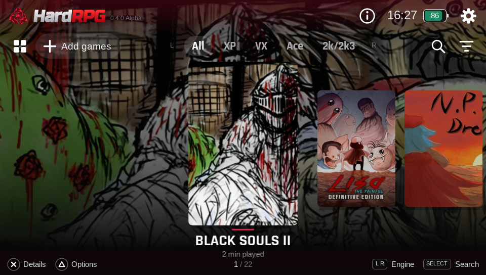</a><br>
      <sub>The library</sub>
    </td>
    <td align="center">
      <a href="docs/images/screenshots/launcher-details.png">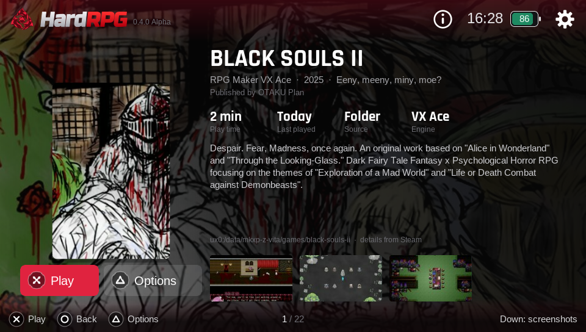</a><br>
      <sub>A game's details</sub>
    </td>
  </tr>
  <tr>
    <td align="center">
      <a href="docs/images/screenshots/launcher-game-settings.png">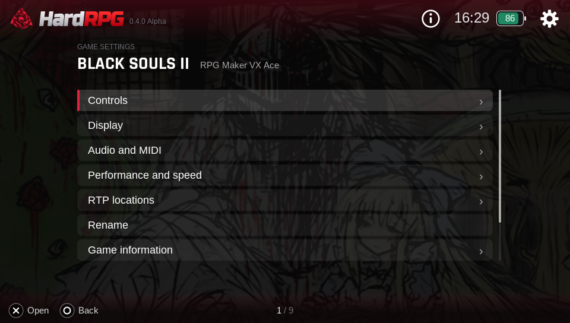</a><br>
      <sub>Settings for each game</sub>
    </td>
    <td align="center">
      <a href="docs/images/screenshots/launcher-controls.png">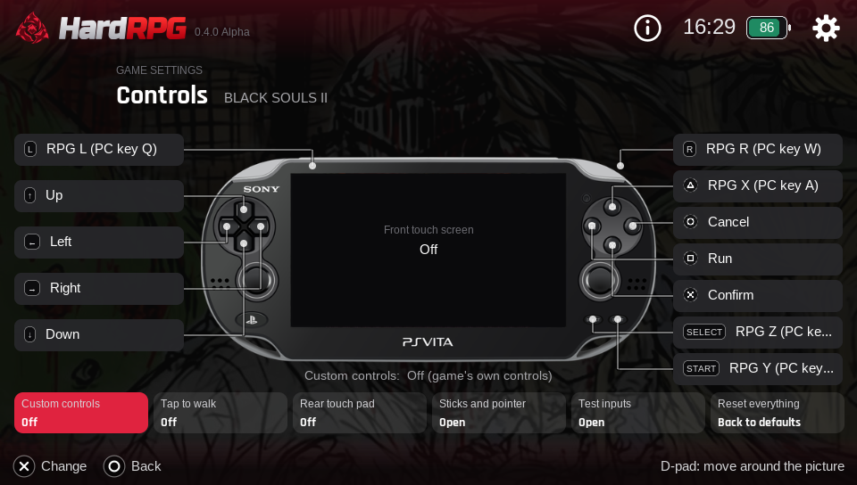</a><br>
      <sub>Controls on a picture of the Vita</sub>
    </td>
  </tr>
</table>

Games, captured on a PS Vita running HardRPG 0.3.0:

<table>
  <tr>
    <td align="center" width="50%">
      <a href="docs/images/screenshots/to-the-moon.png">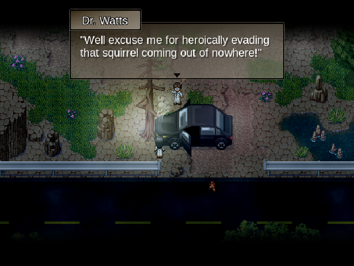</a><br>
      <b>To the Moon</b>
    </td>
    <td align="center" width="50%">
      <a href="docs/images/screenshots/lisa.png">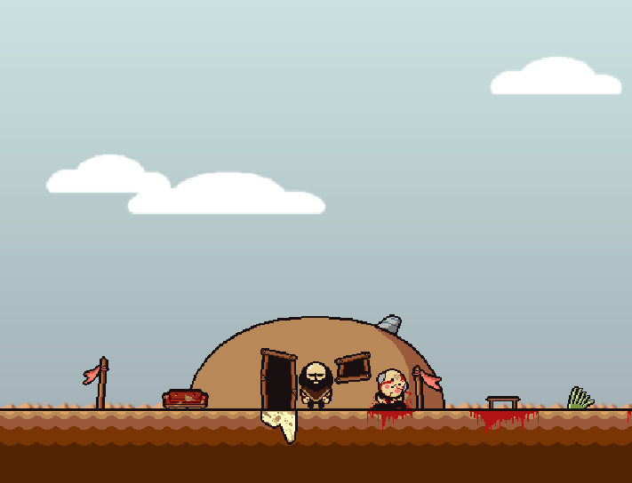</a><br>
      <b>LISA: The Painful</b>
    </td>
  </tr>
  <tr>
    <td align="center" width="50%">
      <a href="docs/images/screenshots/hylics.png">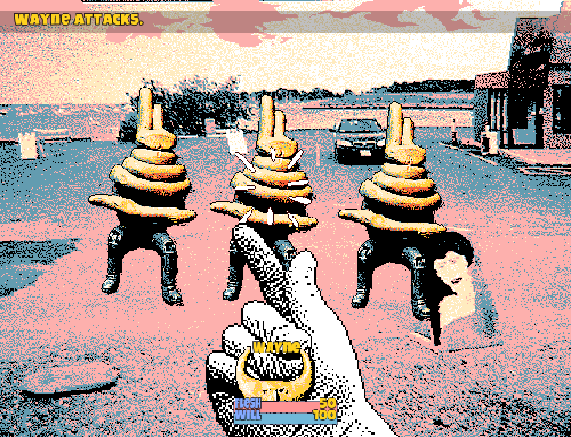</a><br>
      <b>Hylics</b>
    </td>
    <td align="center" width="50%">
      <a href="docs/images/screenshots/the-witchs-house.png">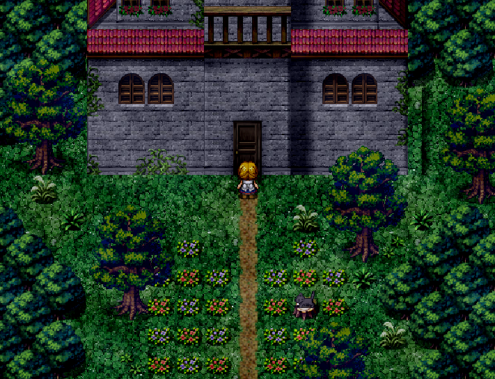</a><br>
      <b>The Witch’s House</b>
    </td>
  </tr>
  <tr>
    <td align="center" width="50%">
      <a href="docs/images/screenshots/ao-oni.png">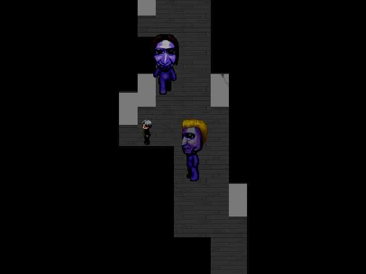</a><br>
      <b>Ao Oni</b>
    </td>
    <td align="center" width="50%">
      <a href="docs/images/screenshots/black-souls.png">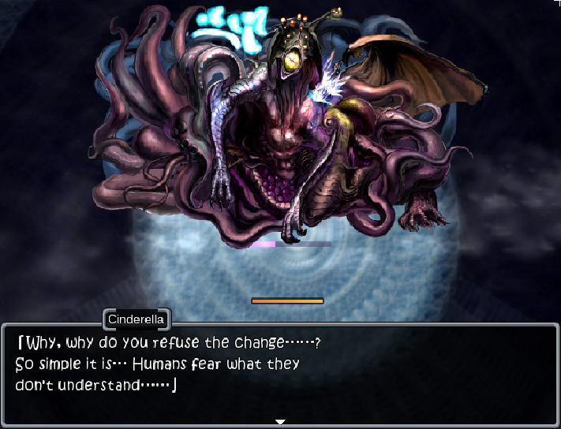</a><br>
      <b>BLACK SOULS</b>
    </td>
  </tr>
  <tr>
    <td align="center" width="50%">
      <a href="docs/images/screenshots/black-souls-ii.png">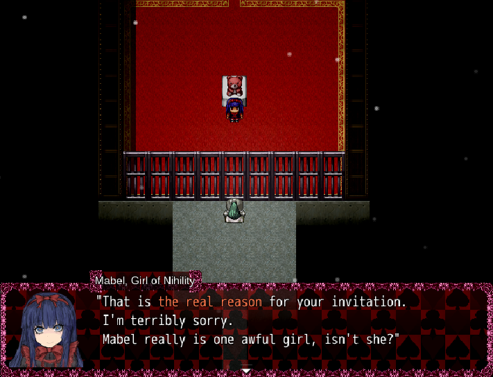</a><br>
      <b>BLACK SOULS II</b>
    </td>
    <td align="center" width="50%">
      <a href="docs/images/screenshots/fnafb-final-mix.png">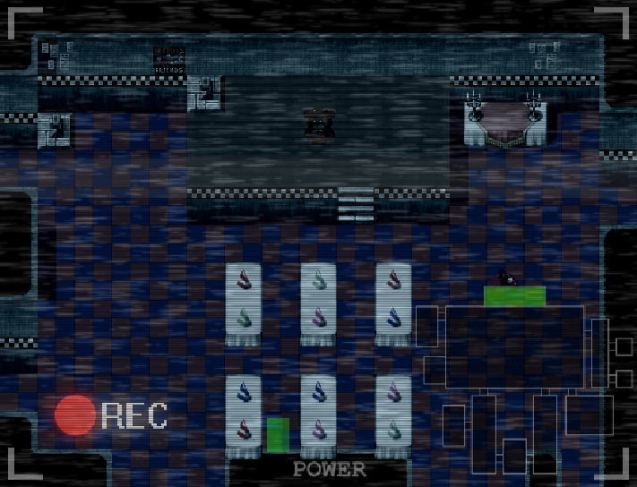</a><br>
      <b>FNaF b Final Mix</b>
    </td>
  </tr>
  <tr>
    <td align="center" width="50%">
      <a href="docs/images/screenshots/mogeko-castle.png">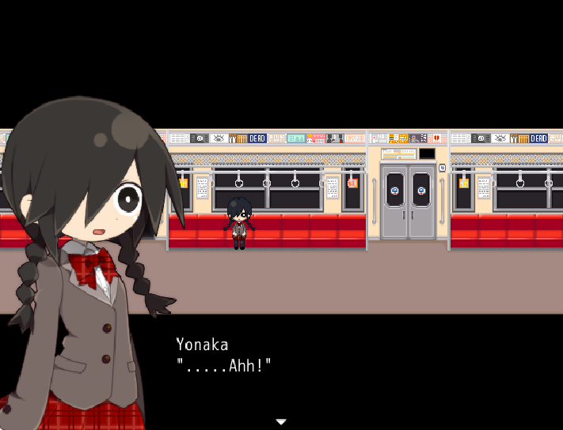</a><br>
      <b>Mogeko Castle</b>
    </td>
    <td align="center" width="50%">
      <a href="docs/images/screenshots/red-hoods-woods.png">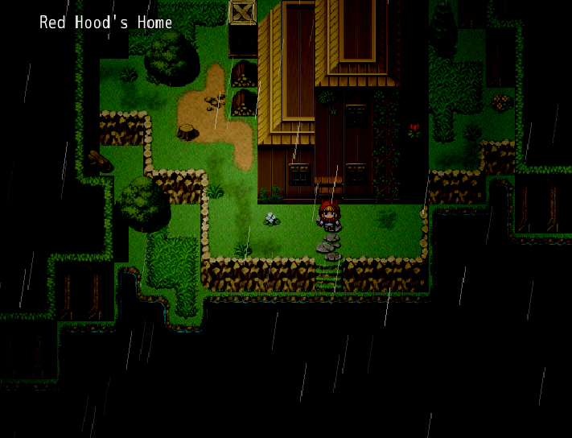</a><br>
      <b>Red Hood’s Woods</b>
    </td>
  </tr>
</table>

## Building

For developers: the [build guide](docs/BUILDING.md) covers the VitaSDK
container, dependencies and VPK packaging. The
[desktop launcher preview](docs/LAUNCHER-PREVIEW.md) runs the launcher on a PC
for quick UI work.

| Directory | Purpose |
| --- | --- |
| `src/`, `binding/`, `shader/`, `assets/` | Engine, Ruby bindings, renderer and built-in resources |
| `backends/` | EasyRPG Player integration for RPG Maker 2000/2003 |
| `launcher/` | Package defaults, scripts loaded into games, LiveArea assets |
| `deps/` | Pinned dependencies and their patches |
| `scripts/`, `ci/` | Build, package, verification and CI |
| `docs/` | Guides, compatibility and README images |

## Credits and licenses

HardRPG is developed by [Asukate](https://github.com/Asukate).
Built on [mkxp-z](https://github.com/mkxp-z/mkxp-z) and Ancurio's original mkxp,
with [EasyRPG Player](https://easyrpg.org/), [VitaSDK](https://vitasdk.org/),
Rinnegatamante's [vitaGL](https://github.com/Rinnegatamante/vitaGL) and
[vitaShaRK](https://github.com/Rinnegatamante/vitaShaRK), Ruby, and the other
libraries listed in [third-party notices](THIRD-PARTY-NOTICES.md).

The engine keeps its GPL-2.0-or-later license; components with GPL v3 and
other terms keep their notices and license texts. See [COPYING](COPYING) and
[LICENSES/](LICENSES/). Games belong to their respective owners.

Header illustration: [Tokyoship, Wikimedia Commons](https://commons.wikimedia.org/wiki/File:PlayStation_Vita_illustration.svg),
[CC BY 3.0](https://creativecommons.org/licenses/by/3.0/), modified by adding a
game image to the screen.
